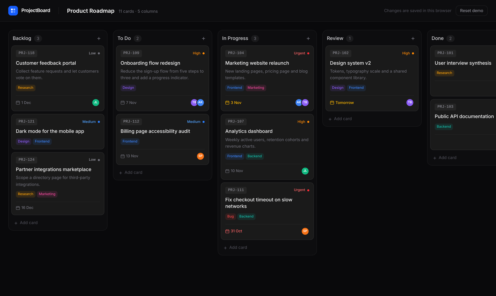

# ProjectBoard

A drag-and-drop kanban board for tracking projects. It runs entirely in the browser: there is no backend, and changes are saved to `localStorage`.



## Features

- **Drag and drop:** move project cards between columns or reorder them within a column. Works with mouse, touch (press and hold), and keyboard.
- **Keyboard accessible:** focus a card, press `Space` to pick it up, use the arrow keys to move it, then `Space`/`Enter` to drop or `Esc` to cancel. Screen readers announce each move.
- **Project cards:** each card has a code, title, description, priority, due date (overdue and due-soon dates are highlighted), tags and assignees.
- **Inline editing:** rename the board and its columns, add and delete columns and cards, and create, rename or delete tags.
- **Saved locally:** the board is saved in the browser, so it's still there after a reload. **Reset demo** restores the sample data.
- **Responsive:** the dark UI also works on small screens.

## Tech stack

- [Next.js 16](https://nextjs.org) (App Router) + React 19 + TypeScript
- [Tailwind CSS 4](https://tailwindcss.com) + [shadcn/ui](https://ui.shadcn.com) (dialog)
- [dnd-kit](https://dndkit.com) for drag and drop
- [Vitest](https://vitest.dev) for unit tests

## Getting started

Requires Node.js 20+.

```bash
npm install
npm run dev     # http://localhost:3000
```

| Command         | Description                   |
| --------------- | ----------------------------- |
| `npm run dev`   | Start the development server  |
| `npm test`      | Run the unit tests            |
| `npm run lint`  | Lint the project              |
| `npm run build` | Build for production          |
| `npm start`     | Serve the production build    |

## How it works

All board changes go through one pure reducer (`src/lib/board.ts`), which makes the logic easy to test without a browser. The `useBoard` hook keeps that state in React and writes it to `localStorage` on every change. The board component is rendered on the client only, so it can read saved data on first render without a hydration mismatch.

During a drag, a card that crosses into another column is moved there immediately, so you can see where it will land. Reordering within a column is applied when you drop the card. If you cancel a drag, the board goes back to how it was before the drag started.

## Project structure

```
.
├── src/
│   ├── app/                 # Next.js entry: layout, page, global styles, icon
│   ├── components/
│   │   ├── board/           # KanbanBoard, KanbanColumn, ProjectCard, CardDetailModal, ...
│   │   └── ui/              # shadcn/ui primitives
│   ├── hooks/useBoard.ts    # Reducer + localStorage persistence
│   └── lib/                 # Board reducer, types, sample data, dates, storage
├── tests/                   # Vitest unit tests
└── docs/                    # README assets
```

## Deployment

Since it's a static frontend, it deploys to [Vercel](https://vercel.com/new) with zero configuration. Import the repository and keep the default Next.js settings.
